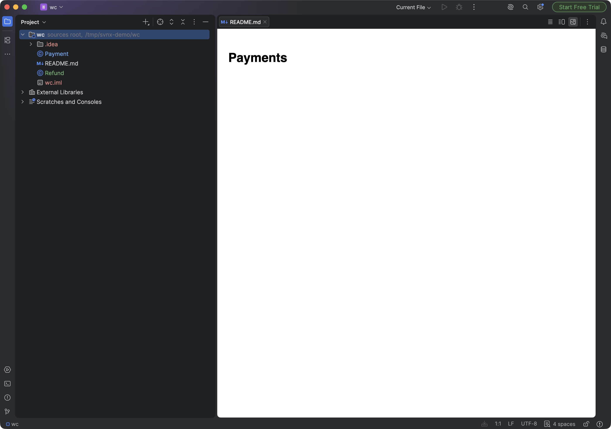
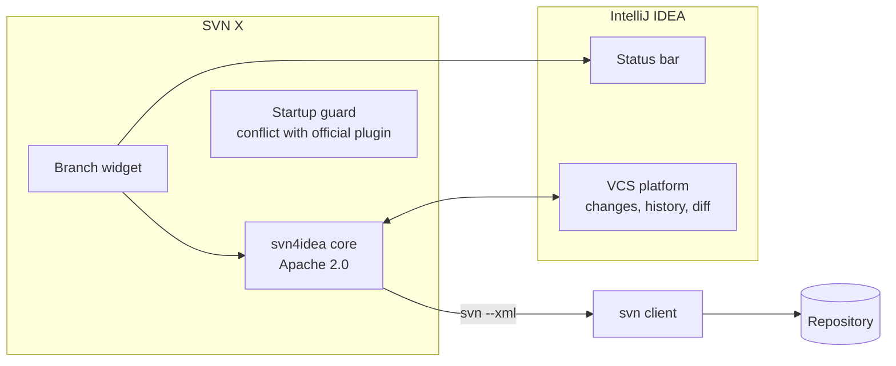
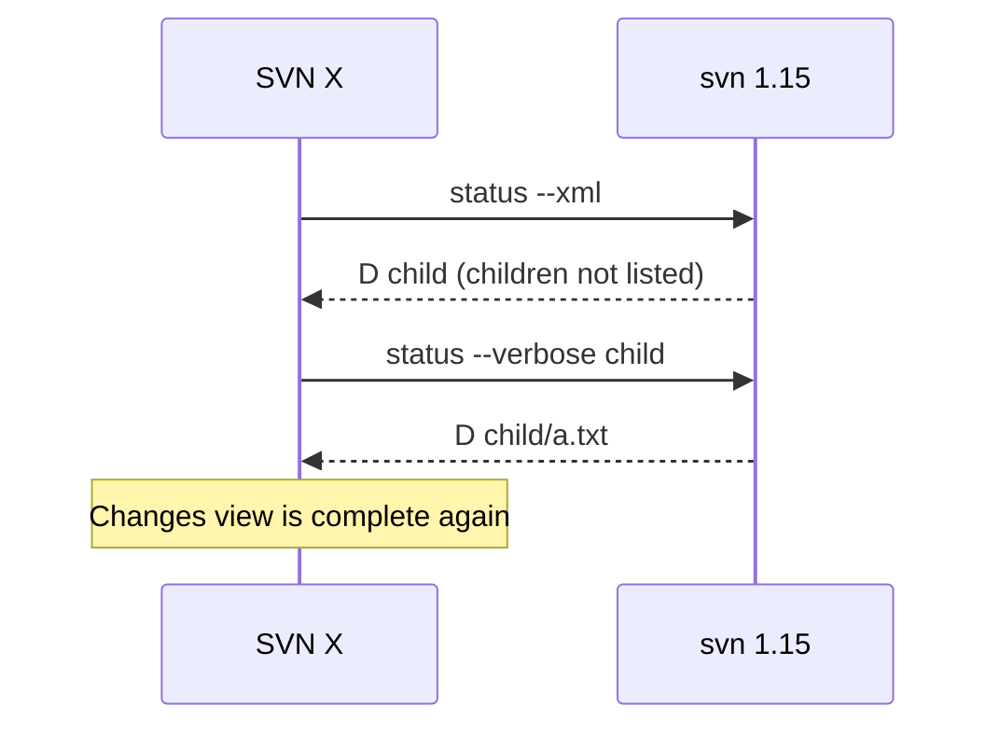

# SVN X


A Subversion plugin for IntelliJ IDEA, for teams that are staying on SVN. It starts from
JetBrains' open-source svn4idea plugin and builds the workflows Git users take for
granted, starting with branch handling.

**Status: early.** It runs in IntelliJ 2026.1 and is not on the Marketplace yet. See
[ROADMAP.md](ROADMAP.md).



## Why it exists

Plenty of teams can't move to Git soon: large histories, binary assets, audit rules, or
tooling built around SVN. Since IntelliJ IDEA 2026.1, Subversion support is no longer
bundled and is installed from the Marketplace. The official plugin still works, and SVN X
doesn't try to replace it for everyone. It focuses on daily comfort for people who live
in SVN, starting with branches, which are buried in menus today.

## Architecture



The plugin drives your own `svn` client and parses its XML output, so it behaves the
same as the command line you already use.

## Two bugs worth reading about

**svn 1.15 hides files.** Plain `svn status` no longer lists the children of a deleted
directory, so files inside a deleted or moved folder disappeared from the Changes view.



A verbose status on every call would be slow, so the plugin asks only about the deleted
directories it finds.

**Green tests, broken plugin.** 242 tests passed while the real IDE failed on every
`svn info` call. The plugin bundled its own JAXB, the IDE ships another, and Java treated
them as two different classes. Tests use a flat classpath, so they could not see it.
Only running the IDE did. The plugin now uses the IDE's copy. The same run exposed an
upstream call that ran `svn` on the UI thread at startup, which now runs in the background.

## Features

| Today | Next |
|---|---|
| Checkout, commit, update, diff, history, merge and conflicts from svn4idea | Revision graph tool window |
| File status in the project view, on a real IDE run | Branch widget in the status bar (written, not appearing yet) |
| Warning when the official plugin is also enabled | `svn:mergeinfo` inspector |

## Quick start
```bash
./gradlew runIde        # sandbox IDE with the plugin
./gradlew test          # upstream test suite against your svn client
./gradlew buildPlugin   # build/distributions/*.zip, install from disk
```

Requires JDK 25 and an `svn` command line client on your PATH. Disable the official
Subversion plugin first: both register as `svn`, and SVN X warns you if both are on.

## Tests

`./gradlew test` runs the upstream suite in a headless IDE against a real `svn`
client. Run one class at a time with `--tests` if you want results quickly; the
full suite takes about 30 minutes.

Latest full run on svn 1.15, class by class, before the JAXB fix:

| Result | Tests |
|---|---|
| Passed | 242 |
| Skipped | 18 |
| Failed | 8 |

The 8 failures are in one area: a file edited inside a renamed or moved directory
can show as modified rather than moved in the Changes view. See `SvnRollbackTest`,
`SvnRenameTest.testRenameFileRenameDir` and
`SvnChangesCorrectlyRefreshedTest.testMoveDirEditFileAndAfterRevert`.

SVN X also fixes a problem with svn 1.15, whose plain `status` command hides the
children of deleted directories. The status client now asks for them separately.

## Compatibility

Plugin Verifier reports Compatible for IntelliJ IDEA 2026.1 (261.27258) and 2026.2
(262.11879). It also flags internal and override-only API usage inherited from
upstream, which still has to be addressed before a Marketplace release.

## Known issues

- The branch widget is registered but does not appear in the status bar yet.
- A file edited inside a renamed directory can show as modified, not moved (the 8 test failures).
- Commit, history and merge pass their tests but have not been walked through by hand in the IDE.

## Not affiliated with JetBrains
This is an independent community fork. "Subversion" plugin code
© 2000–2025 JetBrains s.r.o. and contributors, Apache License 2.0.

