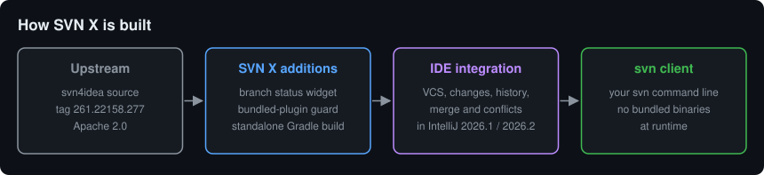

# SVN X

**Git-level comfort for teams that are staying on Subversion.**

SVN X is a standalone fork of IntelliJ's open-source Subversion plugin (svn4idea),
extracted from [JetBrains/intellij-community](https://github.com/JetBrains/intellij-community)
(Apache 2.0). It keeps full SVN support in the IDE and builds on it with the
workflows Git users take for granted, starting with a branch widget in the status bar.



**Status: early.** Phase 0 is done, the first SVN X feature is in, and it is not on
the Marketplace yet. See [ROADMAP.md](ROADMAP.md).

## Features

| Today | Next |
|---|---|
| Everything in svn4idea: checkout, commit, update, diff, history, merge, conflicts | Revision graph tool window |
| Branch widget in the status bar | Branch popup with switch, compare and merge |
| Warning when the official plugin is also enabled | `svn:mergeinfo` inspector |
| Compatible with IntelliJ 2026.1 and 2026.2 (Plugin Verifier) | Commit UX and large working copy performance |

## What's in here
- `src/`, `gen/`, `resources/`, `testSource/`, `testData/` — svn4idea sources
  from intellij-community tag `idea/261.22158.277` (IntelliJ IDEA 2026.1, the
  build this targets), plus the SVN X additions in `src/.../svn/svnx/` and the
  renamed `plugin.xml` (layout preserved; Gradle maps to it directly).
  To move to a newer IDE: re-copy `plugins/svn4idea` from the matching tag and
  re-apply those two changes.
- `build.gradle.kts` — standalone build via IntelliJ Platform Gradle Plugin 2.x
- `RENAME-CHECKLIST.md` — how the fork was detached from the JetBrains plugin
- `ROADMAP.md` — the plan
- `LICENSE.txt` / `NOTICE.txt` — carried over from intellij-community (required)

## Quick start
```bash
./gradlew runIde        # sandbox IDE with the plugin
./gradlew test          # upstream test suite against your svn client
./gradlew buildPlugin   # build/distributions/*.zip, install from disk
```

Requires JDK 25 and an `svn` command line client on your PATH. Disable the official
Subversion plugin first: both register as `svn`, and SVN X warns you if both are on.

## Tests

`./gradlew test` runs the upstream suite in a headless IDE against a real `svn`
client. Run one class at a time with `--tests` if you want results quickly; the
full suite takes about 30 minutes.

Latest run on svn 1.15, class by class:

| Result | Tests |
|---|---|
| Passed | 242 |
| Skipped | 18 |
| Failed | 8 |

The 8 failures are in one area: a file edited inside a renamed or moved directory
can show as modified rather than moved in the Changes view. See `SvnRollbackTest`,
`SvnRenameTest.testRenameFileRenameDir` and
`SvnChangesCorrectlyRefreshedTest.testMoveDirEditFileAndAfterRevert`.

SVN X also fixes a problem with svn 1.15, whose plain `status` command hides the
children of deleted directories. The status client now asks for them separately.

## Compatibility

Plugin Verifier reports Compatible for IntelliJ IDEA 2026.1 (261.27258) and 2026.2
(262.11879). It also flags internal and override-only API usage inherited from
upstream, which still has to be addressed before a Marketplace release.

## Not affiliated with JetBrains
This is an independent community fork. "Subversion" plugin code
© 2000–2025 JetBrains s.r.o. and contributors, Apache License 2.0.

